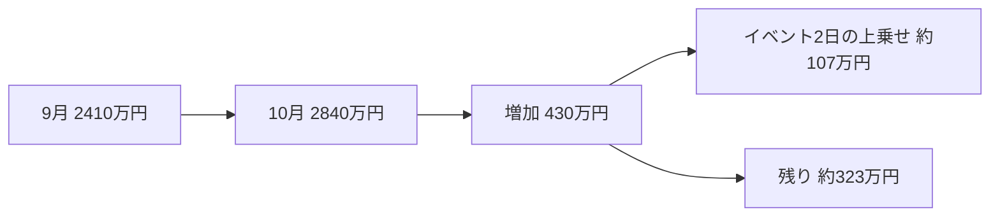

<!-- `-1` モードの見本。デモ用の作り話です。 -->

# 中央店の10月の売上が伸びた理由

結論から言うと、10月12日・13日に近くの公園で開かれた音楽イベントの影響です。
中央店の10月の売上は2,840万円で、前月比18%増でした。

増加分の430万円を分けると、こうなります。



2日間の売上290万円から、平常どおりなら入る183万円を引くと、上乗せは約107万円です。

## 他店舗との比較

週ごとの売上を並べると、他店も同じ時期に伸びています。

```vega-lite
{"data": {"values": [
  {"週":"09-29","店":"中央店","売上":610},{"週":"10-06","店":"中央店","売上":650},{"週":"10-13","店":"中央店","売上":820},{"週":"10-20","店":"中央店","売上":680},
  {"週":"09-29","店":"北店","売上":470},{"週":"10-06","店":"北店","売上":500},{"週":"10-13","店":"北店","売上":530},{"週":"10-20","店":"北店","売上":540},
  {"週":"09-29","店":"南店","売上":450},{"週":"10-06","店":"南店","売上":480},{"週":"10-13","店":"南店","売上":500},{"週":"10-20","店":"南店","売上":510}]},
 "mark": {"type":"line","point":true},
 "encoding": {"x":{"field":"週","type":"ordinal","title":"週"},
              "y":{"field":"売上","type":"quantitative","title":"万円"},
              "color":{"field":"店","type":"nominal","title":"店舗"}}}
```

中央店だけが跳ねているわけではないので、イベントだけで説明するのは無理があります。
