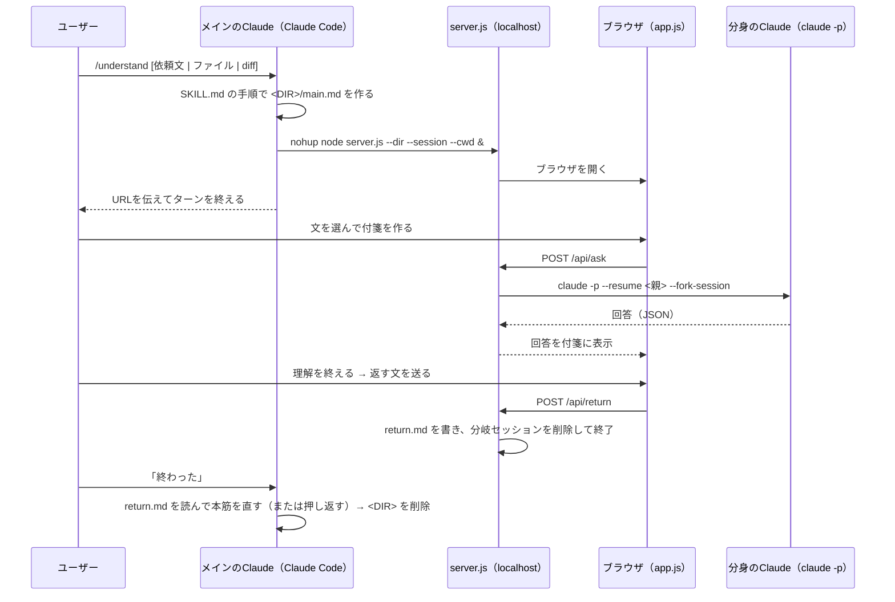

# しくみ

## 全体の流れ



## ファイル

| パス | 役割 |
| --- | --- |
| `skill/understand/SKILL.md` | Claude Code のスキル本体。起動と「終わった」後の手順。`${CLAUDE_SKILL_DIR}` と `${CLAUDE_SESSION_ID}` を使う |
| `skill/understand/pr-guide.md` | 依頼文がPR・ブランチのときの、説明文書の作り方 |
| `skill/understand/app/server.js` | ローカルサーバー。依存パッケージなし（Node 18+ 標準のみ） |
| `skill/understand/app/public/` | 画面（素の JS。ビルドなし） |
| `skill/understand/app/public/vendor/` | marked 12.0.2 / DOMPurify 3.1.6 / mermaid 10.9.1 / vega 5.30.0 / vega-lite 5.21.0 / vega-embed 6.26.0（オフラインで動くよう同梱。ライセンス同梱） |
| `skill/understand/app/config.example.json` | 設定のひな形。インストール時に `config.json` にコピー |
| `dev/` | 開発用（モック、e2e、SQL実行のテスト、サンプルPR作成、スキルのリンク）。デモの題材は作り話です |

## 作業フォルダ `<DIR>`

`mktemp -d` で作る使い捨てのフォルダ。

| ファイル | 書く人 | 中身 |
| --- | --- | --- |
| `main.md` | メインのClaude | 本筋（Markdown） |
| `title.txt` | メインのClaude | 短い題名 |
| `url.txt` / `server.pid` / `server.log` | server.js | 起動情報 |
| `return.md` | server.js | メインに返す文（「理解を終える」で作られる） |

## サーバーのAPI（`server.js`）

| API | 内容 |
| --- | --- |
| `GET /api/init` | `main.md`・題名・プロジェクト名・セッションの有無 |
| `POST /api/ask` | 付箋の質問。初回は `{action, anchor, question, sessionId(親), continueSession:false}` で親から**分岐**。続きは `{followUp, sessionId(この付箋), continueSession:true}` で同じセッションに積む |
| `POST /api/runsql` | 「承認して実行」。参照だけのSQLか検査し、トンネルの疎通を確かめ、SQLをファイルに書いて `psql ... -f` を実行させる。`sqlAllowedTools`（既定 `Bash(psql:*)`）だけを許可。パスワードは環境変数 `PGPASSWORD` で子プロセスに渡す（プロンプトには入れない）。` ```json {columns, rows}` と ` ```vega-lite`（data は書かせない）を返させる |
| `POST /api/draft` | 返す文の下書き。分岐せず、メモだけを渡して軽いモデル（既定 sonnet）で作る |
| `POST /api/return` | `return.md` を書き、このサーバーが作った分岐セッションの `.jsonl` を削除して終了 |

### セッションの木

- 本筋から作った付箋：メインのセッションから分岐
- 付箋の続きの質問：その付箋のセッションに追加
- 子付箋：親の付箋のセッションから分岐（親の寄り道の文脈を引き継ぐ）
- 終了時、`createdSessions` に記録した ID の `~/.claude/projects/<cwdのスラッグ>/<id>.jsonl` を削除（`keepForkedSessions: true` で残せる）

### Claude 呼び出しの安全策

- 質問時は `askDisallowedTools`（Edit / Write / NotebookEdit / Bash）を禁止。編集と、承認前のSQL実行を防ぐ。
- SQL実行時だけ `Bash(psql:*)` を許可する。psql 以外のコマンドは通らない。
- SQLは `readOnlyError()` で検査し、`select`／`with` で始まる1文だけを通す。書き込みや複数文は実行前に弾く。
- SQLは作業フォルダの `.sql` ファイルに書いて `-f` で渡す。クォートが崩れず、Claudeに書き換えられる余地もない。実行後に消す。
- トンネルの疎通は `net.connect` で確かめる（Bashを増やさないため）。
- `-p` モードでは、許可が必要なツールはそもそも拒否される。
- 分身への指示は `SYSTEM_APPEND`（`--append-system-prompt`）。答え方・図・SQL書式・コード抜粋の書式・「本筋への影響：」の書き方を決めている。
- 各アクションの指示文は `ACTION_PROMPTS`（question / detail / term / diagram / data / review）。

## 画面（`app.js`）

### 状態

```js
S = { stickies: {id: Sticky}, order: [id], pan: {x, y}, zoom, seq, focus }
Sticky = {
  id, type,            // question | detail | term | diagram | data | review | memo
  parent,              // 'main' | 親の付箋ID | null（メモ付箋）
  title, anchorText, anchorY, code, lines,   // 選んだ文と位置、コードなら行番号
  x, y, folded, impact,
  sessionId,           // この付箋の分岐セッション
  messages: [{role: 'user'|'assistant'|'error', text, kind?: 'result', at?, sql?, ranSql?: []}],
  memo, busy
}
```

- `sessionStorage` に保存（タブを閉じたら消える＝ログは残さない方針）。

### 描画のきまり

- 本筋・付箋の回答は `marked` → `DOMPurify` で描画し、コードブロックを言語で振り分ける。
  - `mermaid` → 図、`sql` → 承認ボタン付きの箱、`json` の `{columns, rows}` → 結果の表、`vega-lite` → 直前の結果を `data.values` に差し込んでグラフ（点をクリックすると子付箋）
- コードブロックの見出し行「`~~~~python path/to/file.py:12`」は、`marked` の renderer で `data-file` / `data-start` にして、**ファイル名と実際の行番号**を表示する。`diff` は追加・削除行に色を付け、`@@` 見出しがあれば変更後の行番号を振る。
- 本筋のコードは常に行番号付き。選択すると「`file.py 12〜19行目`」を質問に添える。
- 付箋の出どころの文には `mark.anc` を付け、そこから付箋へ線（SVG の曲線）を引く。描き直すたびに `rehighlight` で付け直す。
- 自動でたたむ：`focusSticky` で、対象と祖先・影響あり・作業中以外をたたむ。

## 開発の回し方

| やりたいこと | コマンド |
| --- | --- |
| 費用をかけずにUIを触る | `npm run mock`（偽の claude で起動。`NO_OPEN=1` でブラウザを開かない） |
| 一通りの操作を自動で確認 | 別の端末で `npm run mock` を動かしたまま `npm i && npm run test:e2e` |
| SQL実行まわりを確認 | `npm run test:sql`（Claudeもトンネルも使わない。パスワードの渡り方、参照以外のSQLの排除、トンネル未接続時の停止を見る） |
| 本物の Claude Code で試す | `npm run link` で `~/.claude/skills/understand` にリンクし、Claude Code を開き直す |
| PRモードを試す | `npm run pr-demo` でサンプルリポジトリを作り、そこで `/understand このPRを理解したい` |

偽の claude（`dev/mock-claude.js`）は、指示文に含まれる言葉（「図で説明」「データで確かめたい」「実行を承認しました」など）で決まった応答を返す。指示文を変えたら、ここも合わせる。
